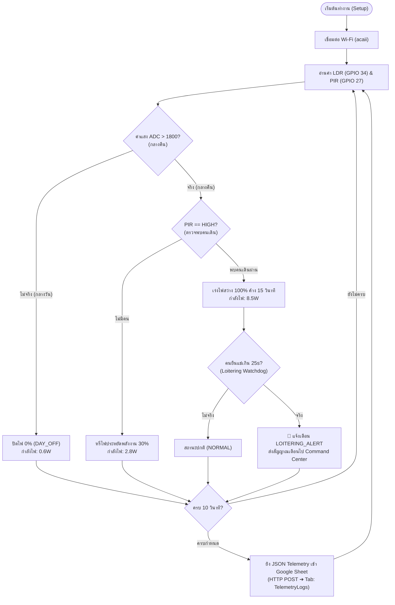

# Campus Safety & Foot-Traffic Telemetry Node (Gym 7)
## Hardware Wiring Diagram & Sensor Calibration Guide

> **Architecture:** 5V DC Mains Grid-Powered • ESP32 Dev Module • Google Apps Script Cloud

---

## 1. Pin Mapping Table (ตารางจับคู่ขาเชื่อมต่อแบบตรงจุด)

| เซนเซอร์ / โมดูล | ขาของโมดูล (Pin Name) | เชื่อมต่อเข้ากับขา ESP32 | หมายเหตุ / ข้อควรระวัง |
| :--- | :--- | :--- | :--- |
| **PIR Motion (HC-SR501)** | **VCC** | **VIN (5V)** | ต้องใช้ไฟ 5V (ชิปเรกูเลเตอร์บนบอร์ด PIR ต้องการไฟขั้นต่ำ 4.5V) |
| | **OUT** | **GPIO 27** | สัญญาณดิจิทัล 3.3V ปลอดภัยสำหรับ ESP32 (ในโค้ดตั้ง `INPUT_PULLDOWN`) |
| | **GND** | **GND** | กราวด์ร่วม (Common GND) |
| **LDR Light Module** | **VCC** | **3V3** (หรือ **VIN 5V**) | แนะนำ 3V3 เพื่อให้ช่วง ADC (0-3.3V) ตรงกับ Full Scale |
| | **GND** | **GND** | กราวด์ร่วม (Common GND) |
| | **AO (Analog Out)** | **GPIO 34** | ขา ADC1 ช่อง 6 (**ใช้งานได้ 100% ขณะเปิด Wi-Fi** ไม่ถูกบล็อกเหมือน ADC2) |
| | *DO (Digital Out)* | *ไม่ต้องต่อ (NC)* | ระบบอ่านค่าแสงเชิงแอนะล็อกผ่านโค้ด |
| **MOSFET Module** | **PWM / SIG** | **GPIO 18** | สัญญาณ LEDC PWM 5kHz (Duty 0 = ดับ, 77 = 30%, 255 = 100%) |
| | **GND** | **GND** | กราวด์ร่วมสัญญาณ |
| | **VCC** (ถ้ามี) | **VIN (5V)** | สำหรับบอร์ดที่มี Optocoupler Isolation |
| **Load Power (ไฟ LED)** | **V+ / DC+** | ไฟบวก 5V หรือ 12V | แหล่งจ่ายไฟเข้าหลอดไฟ LED |
| | **V- / DC-** | กราวด์แหล่งจ่ายไฟ | เชื่อม Common GND |
| | **LED+ / OUT+** | ขั้วบวก (+) ไฟ LED | ขั้วต่อหลอดไฟทางเดิน |
| | **LED- / OUT-** | ขั้วลบ (-) ไฟ LED | สวิตช์ผ่าน N-Channel MOSFET |

---

## 2. Schematic Wiring Diagram (ผังวงจรแบบละเอียด)

```
                     ┌────────────────────────────────┐
                     │     5V DC Mains USB Adapter    │
                     └───────┬────────────────┬───────┘
                           +5V│              GND│
                             │                  │
        ┌────────────────────┴───────────┐      │
        │                                │      │
        ▼                                ▼      ▼
┌───────────────┐               ┌─────────────────────────────────┐
│ PIR HC-SR501  │               │        ESP32 Dev Module         │
│               │               │                                 │
│  [VCC] ───────┼───────────────┤ VIN (5V)                  [GND] ┼──┐
│  [OUT] ───────┼───────────────┤ GPIO 27                         │  │
│  [GND] ───────┼───────────────┤ GND                             │  │
└───────────────┘               │                                 │  │
                                │                                 │  │
┌───────────────┐               │                                 │  │
│ LDR Module    │               │                                 │  │
│               │               │                                 │  │
│  [VCC] ───────┼───────────────┤ 3V3                             │  │
│  [GND] ───────┼───────────────┤ GND                             │  │
│  [AO]  ───────┼───────────────┤ GPIO 34 (ADC1)                  │  │
└───────────────┘               │                                 │  │
                                │                                 │  │
                                │ GPIO 18 (PWM 5kHz)        [GND] ┼──┤
                                └───────┬─────────────────────────┘  │
                                        │ PWM Signal                 │
                                        ▼                            ▼
                                ┌─────────────────────────────────┐  │
                                │      MOSFET Driver Module       │  │
                                │                                 │  │
                                │  [SIG / PWM]                    │  │
                                │  [GND] ─────────────────────────┼──┘ (Common GND)
                                │                                 │
                                │  [DC+ In] ◄─── +5V External     │
                                │  [DC- In] ◄─── GND External ────┴──┐
                                │  [OUT+]   ───► (+) LED Strip       │
                                │  [OUT-]   ───► (-) LED Strip       │
                                └────────────────────────────────────┘
```

---

## 3. Sensor Calibration & Switch Settings (การปรับจูนก่อนติดตั้งจริง)

### 3.1 การปรับเซนเซอร์ตรวจจับความเคลื่อนไหว (HC-SR501)
1. **ตำแหน่ง Jumper (สีเหลือง):**
   - ให้เสียบที่ตำแหน่ง **H (Repeat Trigger)** เสมอ เพื่อให้สัญญาณ OUT ค้าง HIGH ต่อเนื่องตราบใดที่ยังมีคนเดินหรือยืนอยู่ในรัศมีตรวจจับ (สำคัญมากสำหรับฟังก์ชัน Loitering Watchdog 25 วินาที)
2. **ตัวต้านทานปรับค่าได้ (Trimpots 2 ตัว):**
   - **Time Delay (ตัวซ้าย/มีสัญลักษณ์ Sx):** หมุน**ทวนเข็มนาฬิกาจนสุด** (Minimum Delay ~3 วินาที) เพื่อส่งสัญญาณดิบเข้าบอร์ดทันที โดย ESP32 จะเป็นตัวจับเวลาหน่วงไฟค้าง 15 วินาที (`LIGHT_HOLD_TIME`) ในโค้ดเอง
   - **Sensitivity (ตัวขวา/มีสัญลักษณ์ Tx):** หมุนกึ่งกลาง (ประมาณ 4-5 เมตร) หรือปรับเพิ่มตามระยะทางเดินของยิม 7

### 3.2 เซนเซอร์วัดแสงสว่างรอบข้าง (LDR Module)
- ขาต่อสัญญาณ: ใช้ขา **AO (Analog Output)** ต่อเข้า **GPIO 34**
- ตัว Trimpot บนบอร์ด LDR เป็นตัวตั้งค่าของขา DO เท่านั้น แต่ในระบบของเราใช้ค่า Analog ตรงๆ ผ่านเกณฑ์:
  $$\text{LDR\_THRESHOLD} = 1800$$
  - กลางวัน (สว่าง): ค่า ADC อยู่ที่ประมาณ $200 - 800$ $\rightarrow$ โหมด `DAY_OFF` (PWM 0%)
  - กลางคืน (มืด): ค่า ADC อยู่ที่ประมาณ $2200 - 3800$ $\rightarrow$ โหมด `30%_AMBIENT` (PWM 77) หรือ `100%_ACTIVE` (PWM 255)

---

## 4. Verification Flowchart (ลำดับตรรกะการทำงานของโหนด)


